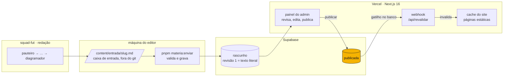

<div align="center">

# Zona Mista · Blog Fut

**Futebol depois do apito.** Análise, crônica e reportagem apuradas por uma redação de agentes de IA, publicadas num portal construído por outro time de agentes.

[**blog-fut-tau.vercel.app**](https://blog-fut-tau.vercel.app)

[](https://github.com/oabnerwilliam/blog-fut/actions/workflows/portoes.yml)


</div>

O **Blog Fut** é o portal **Zona Mista**. Os textos vêm do **squad-fut**, uma redação de agentes do Claude que pauta, apura, escreve, checa, edita e revisa cada matéria. O site é desenvolvido pelo **squad-blog**, um time de agentes de desenvolvimento com TDD, code review e portões de qualidade, coordenado por um Tech Lead. Nenhum dos dois times publica nada sozinho: quem decide o que vai ao ar é uma pessoa.

## O site

<table>
  <tr>
    <td width="50%"></td>
    <td width="50%"></td>
  </tr>
  <tr>
    <td align="center"><sub>Capa · tema claro</sub></td>
    <td align="center"><sub>Capa · tema escuro</sub></td>
  </tr>
</table>


**O que tem no portal**

- Capa com destaque, Últimas e faixas por editoria
- Sete editorias, tags e busca
- Tema claro e escuro, que segue o sistema ou a escolha do leitor
- Layout a partir de 320px, contraste AA, foco visível e navegação por teclado
- SEO: canonical, Open Graph, JSON-LD e sitemap
- Matérias fictícias de exemplo, com selo, aviso e `noindex`
- Painel do admin com login Google, rascunhos, histórico de revisões e editor de texto
- Páginas estáticas que se atualizam em segundos quando uma matéria é publicada

<sub>As imagens são geradas por `pnpm readme:imagens` (Playwright, com o conteúdo de exemplo do repositório).</sub>

<br clear="right" />

## Como funciona

Uma matéria nasce no squad-fut e só entra no ar quando alguém a publica no painel. O texto que o squad entregou fica gravado como **revisão 1** e nunca muda. Toda edição posterior vira uma revisão nova, com autor.



1. O **diagramador** do squad-fut grava a matéria pronta em `content/entrada/`.
2. O **versionador** do squad-blog roda `pnpm materia:enviar <slug>`. O arquivo é validado com o mesmo schema do site e vai ao banco como **rascunho**. O visitante não vê rascunhos, porque o RLS só libera o que está publicado.
3. No **painel**, o admin lê, edita se precisar e publica. Também dá para publicar pelo terminal, com `pnpm materia:publicar <slug>`.
4. O banco chama o **webhook** do site, que invalida só as páginas afetadas. A matéria aparece em segundos, sem build novo.

O passo a passo completo está em [`docs/operacao/materias.md`](docs/operacao/materias.md).

## Os squads

### squad-blog: quem constrói o site

A sessão principal do Claude é o **Tech Lead/orquestrador**. Ela recebe o pedido, aciona os agentes na ordem certa, roda o git e decide quando uma história está pronta. Os agentes ficam em [`.claude/agents/`](.claude/agents/):

| Agente        | Papel                                                                                                            |
| ------------- | ---------------------------------------------------------------------------------------------------------------- |
| `planejador`  | Escreve a história com critérios de aceite verificáveis e notas técnicas; registra um ADR quando há decisão real |
| `designer`    | Identidade visual, mockups (claro e escuro, celular e desktop) e tokens                                          |
| `dev`         | Implementa com TDD                                                                                               |
| `revisor`     | Code review, testes dos riscos que faltam e os cinco portões, numa passada                                       |
| `homologador` | Só com UI nova: sobe o site, navega como leitor e tira screenshots                                               |
| `versionador` | Envia as matérias da caixa de entrada ao banco como rascunho e publica quando o usuário pede                     |

O fluxo de cada história, de ponta a ponta, está no [`CLAUDE.md`](CLAUDE.md).

### squad-fut: quem escreve as matérias

O squad-fut é a redação, num repositório à parte. Oito agentes trabalham em sequência, como numa redação de verdade: o **pauteiro** define ângulo e roteiro, o **pesquisador** apura com fontes, o **redator** escreve, o **checador** confere cada fato contra a apuração, o **editor** lapida, o **revisor** cuida da língua, o **titulista** propõe título e linha fina e o **diagramador** entrega a matéria na caixa de entrada do Blog Fut, sem mexer no texto.

## Stack

| Camada        | Tecnologia                                                                                                                                    |
| ------------- | --------------------------------------------------------------------------------------------------------------------------------------------- |
| Framework     | Next.js 16 (App Router), React 19, TypeScript                                                                                                 |
| Estilo        | Tailwind CSS v4, tokens próprios ([ADR 0007](docs/adr/0007-tailwind-v4.md))                                                                   |
| Conteúdo      | Markdown com unified/remark/rehype, saneado ([ADR 0004](docs/adr/0004-pipeline-de-markdown-e-sanitizacao.md))                                 |
| Banco e login | Supabase: Postgres, RLS e Auth com Google ([ADR 0008](docs/adr/0008-supabase-como-fonte.md), [0009](docs/adr/0009-autorizacao-perfis-rls.md)) |
| Hospedagem    | Vercel, com as funções em São Paulo                                                                                                           |
| Testes        | Vitest, Playwright e axe-core                                                                                                                 |

## Para desenvolver

**Requisitos:** Node 22+, pnpm 10 e, para os testes de banco, Docker.

```bash
pnpm install
pnpm exec playwright install chromium   # só na primeira vez, para os testes e2e
pnpm dev                                # http://localhost:3000
```

Sem nenhuma configuração, o site lê as matérias de exemplo de `content/materias/`.

### Fontes de conteúdo

As páginas pegam os dados só por `getRepository()` (`src/lib/content`), e a fonte é escolhida por `CONTENT_SOURCE`:

| Valor            | De onde lê                                                                                    |
| ---------------- | --------------------------------------------------------------------------------------------- |
| `files` (padrão) | `content/materias/*.md` e `content/tags.json`. São as fixtures de dev e testes                |
| `supabase`       | O banco, com a chave anon. Exige `NEXT_PUBLIC_SUPABASE_URL` e `NEXT_PUBLIC_SUPABASE_ANON_KEY` |

Outras variáveis: `MOSTRAR_EXEMPLOS` esconde as matérias fictícias, `SITE_URL` é a URL pública (canonical e Open Graph) e `ADMIN_HABILITADO` liga o painel. Um valor inválido é erro, nunca cai no padrão em silêncio. Para subir o banco local e gerar o `.env.local`, veja [`docs/operacao/supabase-local.md`](docs/operacao/supabase-local.md).

### Portões de qualidade

Todos ficam verdes antes de cada merge e rodam no CI em todo PR ([`portoes.yml`](.github/workflows/portoes.yml)):

```bash
pnpm lint        # ESLint
pnpm typecheck   # next typegen + tsc
pnpm test        # Vitest: unidade e integração
pnpm test:e2e    # Playwright: build + start, com e sem banco
pnpm build       # build de produção
pnpm test:db     # Supabase local no Docker: RLS, funções SQL, painel e webhook
```

### Operação

| Documento                                                            | Assunto                                               |
| -------------------------------------------------------------------- | ----------------------------------------------------- |
| [`docs/operacao/materias.md`](docs/operacao/materias.md)             | Enviar e publicar matérias                            |
| [`docs/operacao/supabase-local.md`](docs/operacao/supabase-local.md) | Banco local, `.env.local`, webhook e admin no local   |
| [`docs/operacao/colocar-no-ar.md`](docs/operacao/colocar-no-ar.md)   | Deploy na Vercel e estado da produção                 |
| [`docs/operacao/contas-v2.md`](docs/operacao/contas-v2.md)           | Contas e segredos que a produção usa (sem os valores) |

> O repositório é público: nunca commite `.env*` nem segredos.

## Documentação

- **Spec:** [`docs/superpowers/specs/2026-11-19-blog-fut-design.md`](docs/superpowers/specs/2026-11-19-blog-fut-design.md)
- **Histórias:** [`docs/backlog/`](docs/backlog/) · **Tarefas:** [`docs/tarefas/FILA.md`](docs/tarefas/FILA.md)
- **Design:** [`docs/design/`](docs/design/) · **Decisões (ADRs):** [`docs/adr/`](docs/adr/)
